# П04

- 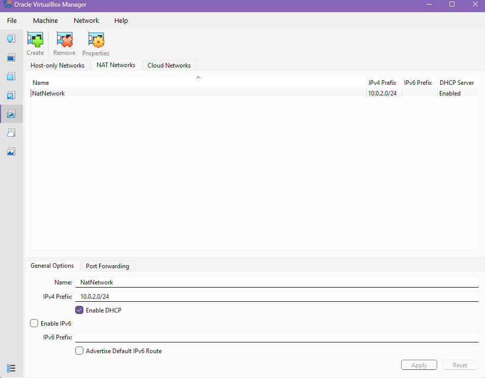\
  *Сеть NAT*

- 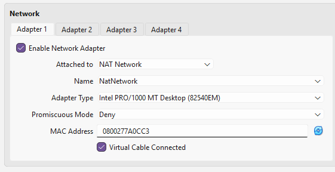

- 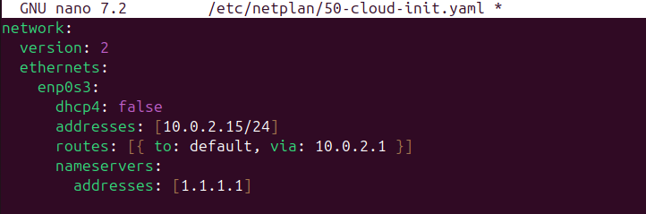
    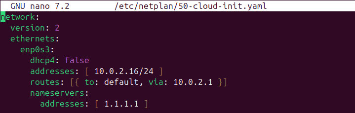\
  *Нетпланы виртуалок*

- 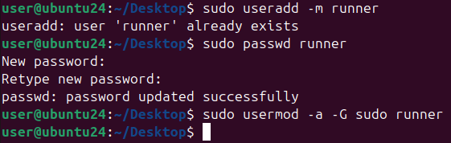\
  *Создаем пользователя раннер, задаем пароль, даем судо права*

- 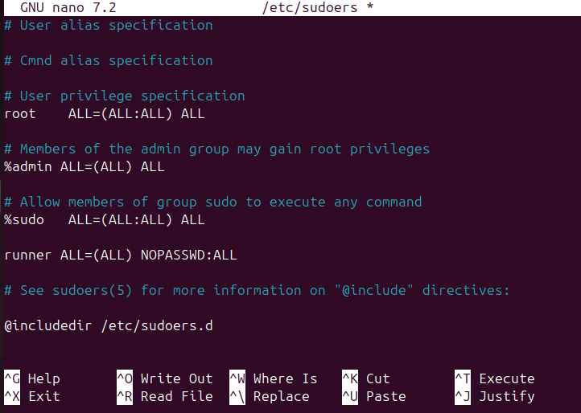
- 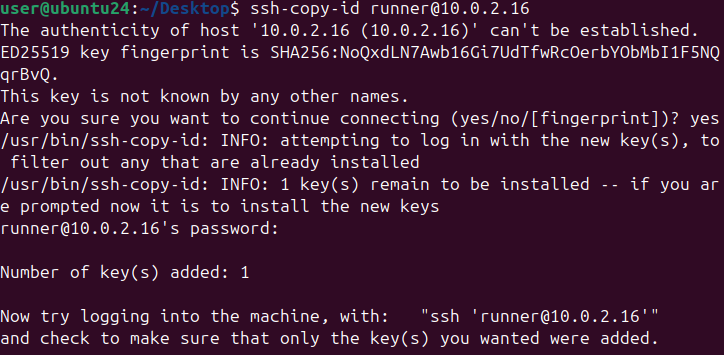\
  *Копируем ssh на вторую машину для досутпа по ssh без пароля*

- 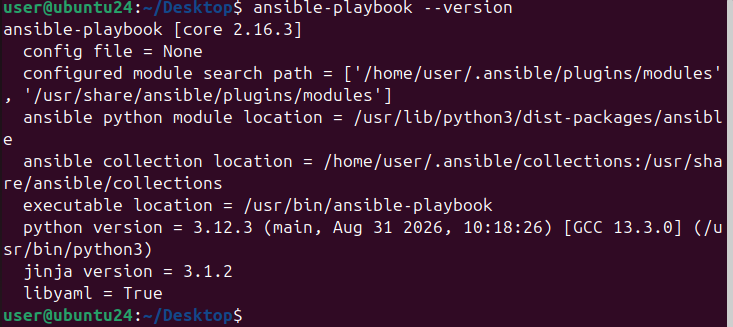
- 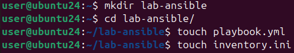
- 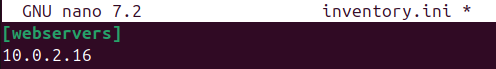
- 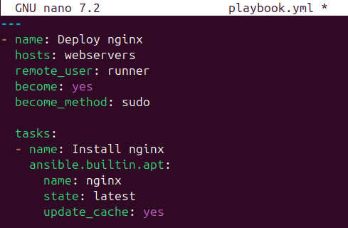

- 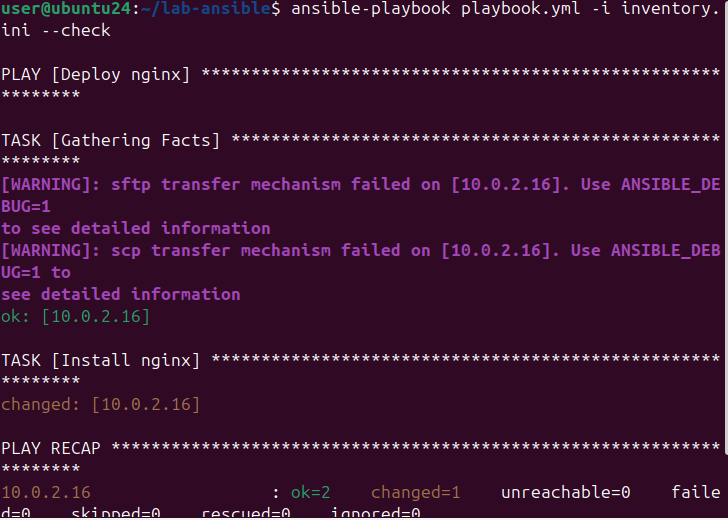\
  *Тестовый запуск плейбука выполнен успешно, варнинг говорит что на второй машине не настроен sftp и scp*

- 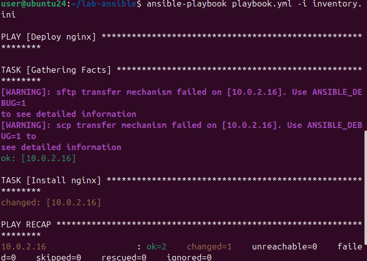\
  *Боевой прогон плейбука*

- 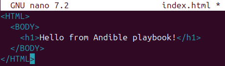
- 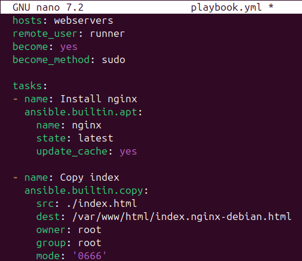
- 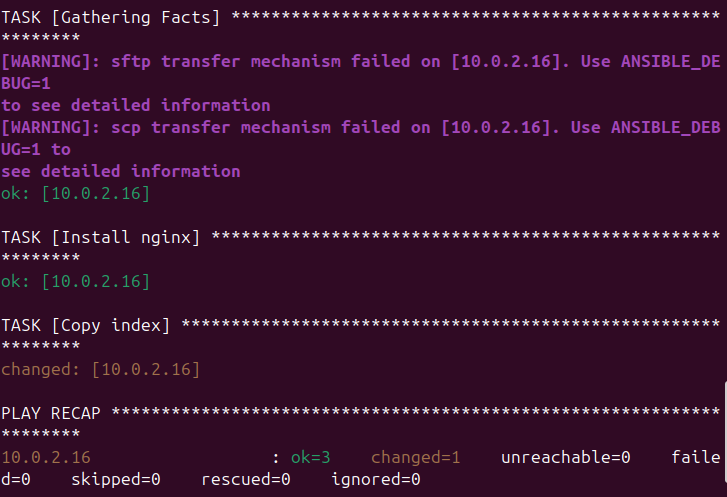
- 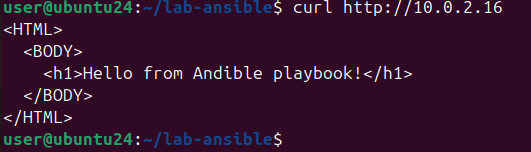